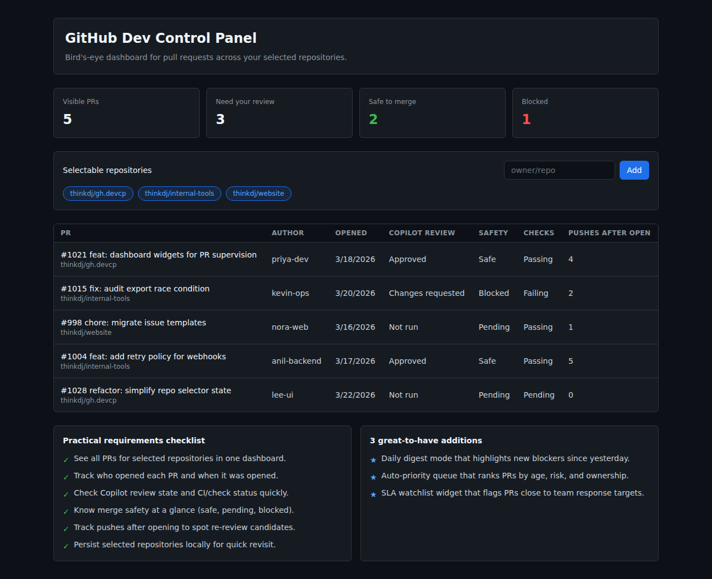

# PR Pulse – The GitHub Control Panel

A lightweight GitHub control panel for monitoring pull requests, branches, and Copilot analytics across your repositories.

Built with **TypeScript + React + Tailwind CSS + TanStack Query** using Vite.

## What it solves

When notifications become noisy, this dashboard gives a bird's-eye view of PRs that need your attention across selectable repositories.


<figcaption><em>Dashboard preview with repository filters, summary widgets, and PR status indicators.</em></figcaption>

## Features

- **Live GitHub API integration** — fetches open PRs, reviews, and check-run status in real time using your GitHub PAT
- **Repository picker modal** — browse your GitHub repos with checkboxes; also supports manual owner/repo entry
- **Repository selector** — toggle and remove tracked repositories; selection persists in localStorage
- **Summary widgets** — clickable at-a-glance counts for open PRs, items needing your review, safe-to-merge, and blocked
- **Color-coded status badges** — visual indicators for CI checks, Copilot review state, and merge safety
- **Theme palettes + dark / light** — Slate (default), Warm, Ocean, Ember; brightness toggle; preferences in `localStorage`
- **My actions** — tab surfacing PRs that need your review and related follow-ups
- **Branch analysis** — optional per-repo run: stale / merged / active branch table, search, copy branch name, GitHub links
- **Copilot Analytics** — org-level Copilot usage metrics plus personal-account Copilot Pro billing analytics and premium-request usage
- **PR search and filtering** — search by title/author/number, filter by author/repo/label dropdowns, hide drafts / Copilot / yours
- **Sortable columns** — sort by title, repo, author, opened, updated, checks, Copilot, merge safety, pushes, comments
- **Relative time** — e.g. "5 minutes ago" (full datetime on hover); color-coded by age where relevant
- **PR detail side panel** — metadata, activity thread, optional comment (needs write permission on the repo)
- **"Needs your review" highlighting** — amber dot and subtle background on PRs awaiting your review
- **Draft PR indicator** — clearly marks draft PRs in the table
- **Label display** — color-coded labels on each PR row, clickable to filter
- **Push count tracking** — highlights PRs with many pushes after opening (potential re-review candidates)
- **Auto-refresh** — data refreshes every 5 minutes; manual refresh button available
- **Error handling** — clear messages for auth failures, rate limits, and API errors
- **Clean zero state** — welcoming empty state when no token is configured; no dummy data

## Architecture

```
src/
├── types.ts              # Shared type definitions (PullRequest, BranchAnalysis, Copilot metrics)
├── github-api.ts         # GitHub REST API client
├── storage.ts            # localStorage helpers (repos, token & theme)
├── utils.ts              # Formatters and relative-time helper
├── seed-data.ts          # Seed data for tests
├── components/
│   ├── StatusBadge.tsx, SummaryWidgets.tsx, RepoSelector.tsx, RepoPickerModal.tsx
│   ├── PullRequestTable.tsx, TokenSettings.tsx, PRDetailPanel.tsx, ConfirmDialog.tsx
│   ├── BranchAnalysisPanel.tsx, ActionRequiredPanel.tsx
│   ├── CopilotMetricsPanel.tsx
├── App.tsx               # Dashboard orchestrator
├── App.test.tsx          # Component & integration tests
├── main.tsx              # Entry point
├── index.css             # Theme tokens & global styles
└── test/
    └── setup.ts          # Vitest setup
```

- **Storage:** `localStorage` for repo selection/theme and encrypted token persistence (plus one-way token fingerprint)
- **Data fetching:** GitHub REST API via `fetch` with TanStack Query for caching, refetch, and error handling
- **UI:** GitHub-inspired styling with Tailwind CSS; in-memory response cache (~3 min TTL) for GETs

If you later need multi-device sync, audit history, or team-shared state, Cloudflare Wrangler services (D1/KV) can be added as a next step.

## GitHub API usage and rate limits

Figures below are **typical for github.com REST** with a valid token; see [GitHub’s rate limit docs](https://docs.github.com/en/rest/using-the-rest-api/rate-limits-for-the-rest-api) for the source of truth (limits can change).

| Context                          | Rough limit                                           |
| -------------------------------- | ----------------------------------------------------- |
| **Authenticated** (PAT or OAuth) | **5,000 requests/hour** per user (primary REST limit) |
| **Unauthenticated**              | **60 requests/hour** (this app always uses a token)   |

GitHub may also apply **secondary** throttling (e.g. concurrent requests, abuse detection). The UI surfaces **403** responses when the primary hourly budget is exhausted.

**Rough request cost (order of magnitude):**

- **PR dashboard (per repo, per refresh):** list open PRs, then per PR fetches for reviews + check runs (cached ~3 minutes in-app).
- **Branch analysis (per repo, per run):** one repo metadata call, paginated branch list, then **~2 calls per branch** (commit + compare vs default). Large repos can mean **hundreds** of calls in one run—use a subset of repos or rerun sparingly if you hit limits.

## Setup

```bash
npm install
npm run dev
```

Open http://localhost:5173, click **Set token**, and paste a GitHub token with the minimum access needed for the tabs you plan to use.

### Required token permissions

Use a **fine-grained Personal Access Token** scoped to the repositories (or the entire account) you want to monitor for the PR, branch, and most dashboard features.

| Area / Scope | Access | Used for |
| --- | --- | --- |
| **Pull requests** (fine-grained repo permission) | Read-only | Fetch open PRs, review state, requested reviewers, PR metadata, and PR detail panel activity |
| **Checks** (fine-grained repo permission) | Read-only | Fetch CI check-run status for each PR |
| **Metadata** (fine-grained repo permission) | Read-only | List repositories in the repo picker and read basic repo metadata |
| **Contents** (fine-grained repo permission) | Read-only | Recommended for branch analysis on private repos, where branch/compare lookups can otherwise fail with 403 |
| **Issues** or **Pull requests** (fine-grained repo permission) | Read/Write only if you want to post comments | Post a comment from the PR detail panel |
| **Account billing access** (your own account) | Read-only | Personal Copilot analytics in the Copilot tab via `/users/{username}/settings/billing/usage` and `/users/{username}/settings/billing/premium_request/usage` |
| `read:org` (classic PAT or OAuth scope) | Read-only | List org memberships, fetch org Copilot analytics, and fetch org Copilot billing data |
| `manage_billing:copilot` (classic PAT or OAuth scope) | Read-only for this app | Fetch org Copilot billing / seat data and, where allowed by GitHub, org Copilot metrics |

Branch listing and comparisons may require **Contents: Read** (or broader repo access) on fine-grained tokens for private repositories—if analysis fails with 403, widen read access for those repos.

If you only want the **Pull requests** and **Branch analysis** tabs, a fine-grained PAT is usually enough. If you also want the **Copilot Analytics** tab for organization data, you will typically need a **classic PAT** (or OAuth token) with the org scopes listed below, because GitHub documents the org Copilot endpoints with `read:org` / `manage_billing:copilot` scopes.

#### Copilot Analytics tab

The **Copilot Analytics** tab supports two data sources:

1. **Personal account analytics** — backed by GitHub billing usage endpoints for the authenticated user.
2. **Organization analytics** — backed by GitHub Copilot org billing / metrics endpoints.

##### Personal account analytics (GitHub Copilot Pro / Pro+)

| Permission / access | Access | Used for |
| --- | --- | --- |
| **Read access to your own account billing data** | Read-only | Load Copilot-billed usage and premium request usage for your personal account |

> **What GitHub exposes for personal accounts:** GitHub does **not** expose the same IDE adoption breakdown API for personal Copilot plans that it exposes for organizations. In this app, the personal view shows the analytics GitHub does expose publicly for personal accounts: billing usage and premium request usage.

##### Organization analytics

| Scope / Permission              | Access    | Used for                                                    |
| ------------------------------- | --------- | ----------------------------------------------------------- |
| `read:org`                      | Read-only | List org memberships, fetch org Copilot metrics, fetch org Copilot billing data |
| `manage_billing:copilot`        | Read-only | Fetch org Copilot billing / seat details and org Copilot metrics where permitted |

> **Note:** Organization Copilot analytics require the token owner to be an **org owner** or **billing manager** in the target organization. The panel shows a helpful error banner if the token lacks sufficient access.

> **Premium requests percentage** (as shown in GitHub's billing UI) is not available through the public GitHub REST API. The dashboard instead surfaces the acceptance rate, seat utilisation, and engagement rate as the key quality and adoption indicators.

> **Security note:** The token is stored encrypted in your browser's `localStorage` and remains until you clear it from PR Pulse settings or browser storage.
> `localStorage` also keeps a one-way token fingerprint for state tracking.
> For best security, use a **fine-grained Personal Access Token** with the minimum required permissions
> (read-only access to pull requests, checks, and repository metadata). Avoid classic tokens with broad
> scopes. If you suspect your browser environment may be compromised, use a short-lived token or clear
> it after each session via the settings panel.

## Scripts

- `npm run dev` — start development server
- `npm run lint` — run ESLint
- `npm run test` — run unit tests (Vitest)
- `npm run build` — type-check and build
- `npm run preview` — preview production build

## GitHub Pages CI/CD

- Workflow file: `.github/workflows/deploy-gh-pages.yml`
- Deploys automatically on pushes to `main` and supports manual dispatch.
- CI/CD pipeline runs `npm ci`, `npm run lint`, `npm run test`, and then builds with:
  - `npm run build -- --base=/<repo-name>/`
- Build output from `dist/` is published via GitHub Pages actions.

## Testing

Focused tests validate:

- Dashboard renders summary widgets with seed data
- Repository toggle filters visible PR counts
- localStorage hydration and persistence
- Invalid JSON fallback to defaults
- Settings panel visibility toggle
- PR filter buttons (All / Needs review)
- Repository removal
- Branch analysis panel and filtering
- My Actions tab
- PR detail panel open/close, Close PR, Delete branch actions
- Copilot Analytics tab navigation, panel rendering, usage bars
